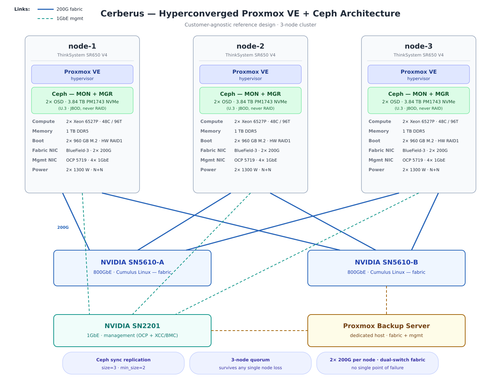

# Cerberus

The reusable hyperconverged **Proxmox VE + Ceph** runbook — three nodes standing guard.

## What this is

A customer-agnostic, step-by-step runbook for designing, building, and validating a
hyperconverged Proxmox VE + Ceph cluster (3 nodes, 4th optional): synchronous
replication, Proxmox Backup Server, HA, and failure testing. Built from real
deployment work and anonymized throughout (role-based names only), so it can be
reused for any customer — and for the lab.

## Status

Design phase. The locked-in decisions, hardware baseline, open questions, and the
full section outline live in [docs/runbook-starting-point.md](docs/runbook-starting-point.md).
The step-by-step runbook is being built section by section under `runbook/`.

## Layout

- `docs/runbook-starting-point.md` — design decisions, hardware baseline, open questions, section outline
- `docs/site-profile-flat.md` — how the template instantiates on a flat IP plan (one mgmt /24, per-role data /24s): Ceph addressing variant, PBS host rule, Netris bootstrap, phased bring-up
- `docs/customer-design-brief.md` (+ `.docx`, `.pdf`) — customer-facing design brief: architecture, specs, protection story
- `docs/customer-protection-brief.md` — one-page "you are protected" high points
- `docs/references.md` — curated official documentation links per runbook section
- `docs/diagrams/` — architecture.svg/png and cable-diagram.svg/png (generated programmatically)
- `runbook/` — the full step-by-step (one directory per section)
- `scripts/` — idempotent, guarded automation (preflight checks, `--dry-run`, confirmations)

## Conventions

- **Customer-anonymized:** role-based node names (`node-1`, `node-2`, `node-3`), no customer
  identifiers anywhere, credentials as placeholders.
- **Variables-first:** per-site values go in `runbook/00-overview/variables.sh`; everything
  else is copy-paste.
- **Baremetal-up:** no vendor integration kit assumed — the runbook owns physical bring-up
  verification (section `00a`) through final validation.
